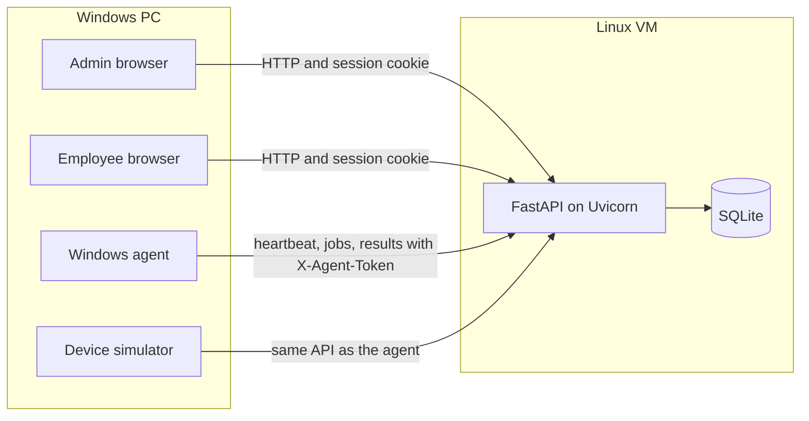

# ManaGit - Centralized IT Management & Remote Support Platform

A prototype platform that lets an IT administrator monitor a company's computers from one place, run safe remote diagnostics, and handle employee support tickets. It was built as a four-day project and tested in a small VirtualBox lab. It is a learning prototype, not a production system.

## Features
- **Device inventory and monitoring:** devices register themselves and report CPU, RAM and disk usage. Online or offline status comes from heartbeats (offline after 90 seconds without one).
- **Windows agent:** a small Python agent with retries, local logging, a permanent device identity and token authentication.
- **Safe remote diagnostics:** ping, DNS lookup, TCP port check, system information and resource check. Only these five operations exist. Parameters are validated on the server and again on the agent, and no shell is ever used.
- **Employee portal:** employees report a problem about their own device and follow the status and resolution of their tickets.
- **Ticket management:** an admin dashboard to filter tickets, change their status, link a device and write a resolution note (required to resolve).
- **Authentication and roles:** hashed passwords, server-side sessions, administrator and employee roles, and brute-force protection.
- **Device simulator:** fake devices that stay online or drop offline, so the dashboard looks like a small company network.

## Architecture



More detail: [architecture](docs/architecture.md), [network plan](docs/network-plan.md), [API reference](docs/api.md), [database notes](database/schema_notes.md), [test report](docs/test-plan.md).

## Tech stack

| Area | Technology |
|---|---|
| Backend | Python, FastAPI, SQLAlchemy |
| Database | SQLite |
| Front-end | HTML, CSS, JavaScript (no framework, no build step) |
| Agent | Python, psutil, requests |
| Lab | VirtualBox, Ubuntu Server, Host-Only network, SSH |
| Tools | Git and GitHub |

## Repository layout

```text
managit/
├── backend/
│   ├── app/
│   │   ├── api/         routers: auth, devices, monitoring, diagnostics, tickets
│   │   ├── models/      SQLAlchemy models
│   │   ├── schemas/     Pydantic schemas
│   │   ├── security/    password hashing, sessions, agent token
│   │   ├── services/    diagnostics allowlist and validation
│   │   ├── database.py
│   │   └── main.py
│   ├── create_user.py   creates users (asks for the password)
│   ├── requirements.txt
│   └── .env.example
├── agent/               Windows agent, diagnostics module, simulator
├── frontend/            login, admin and employee pages
├── database/            schema notes (the .db file is created at first start)
├── docs/                architecture, network plan, API, test report
└── tests/               end-to-end API tests
```

## Quick start

### 1. Server (Linux)

```bash
git clone https://github.com/<your-username>/managit.git
cd managit
python3 -m venv venv
source venv/bin/activate
pip install -r backend/requirements.txt

# shared secret between the server and the agents
echo "AGENT_TOKEN=$(python -c 'import secrets; print(secrets.token_urlsafe(32))')" > backend/.env

# create an administrator and an employee (the password is asked interactively)
cd backend
python create_user.py --username admin --role admin --full-name "IT Administrator"
python create_user.py --username employee1 --role employee --full-name "First Employee" --device-id 2

# run the API
uvicorn app.main:app --host 0.0.0.0 --port 8000
```

Open `http://<server-ip>:8000/` and log in. The `--device-id` links an employee to their device, so create that user after the device has registered (see `/api/devices`).

### 2. Agent (Windows)

```powershell
cd managit
python -m venv venv
.\venv\Scripts\python.exe -m pip install -r agent\requirements.txt
Copy-Item agent\config.example.json agent\config.json
# edit agent\config.json: set server_url and the same agent_token as the server
.\venv\Scripts\python.exe agent\windows_agent.py
```

### 3. Simulator (optional)

```powershell
.\venv\Scripts\python.exe agent\simulator.py
```

It registers 8 fake devices. Some stop sending heartbeats after 2 to 4 minutes so you can see offline devices.

### 4. Tests

```bash
python3 tests/e2e_api.py
```

## Security summary
- Passwords are hashed with scrypt and a random salt. Only a hash of each session token is stored.
- Roles are enforced on the server. Employees can only create and read their own tickets.
- Agent traffic is authenticated with a shared token, and the secrets (`.env`, `config.json`) are never committed.
- Diagnostics use a fixed allowlist, strict validation and no shell.
- Data from the API is displayed with `textContent`, which prevents HTML injection.

## Known limitations
- **No HTTPS.** The lab uses plain HTTP, so the session cookie is not marked `Secure`. A real deployment needs TLS.
- **One shared agent token** for all agents. A production system would use one credential per device.
- **Login lockout is stored in memory**, so it resets when the server restarts.
- **No CSRF token.** `SameSite=Lax` covers the main risk in this setup.
- **No security headers** such as a Content-Security-Policy.
- **No user management screen.** Users are created with a script, and there is no password change page.
- **The lab has one real endpoint** (the Windows PC) plus simulated devices. The Linux and network-device parts were not implemented.
- **SQLite and no migrations.** Fine for a small lab, but it is the main scaling limit, and schema changes are manual.
- **Diagnostics have up to 5 seconds of latency**, because agents poll for jobs.

## Possible future work
- HTTPS and per-device agent credentials
- Linux agent and SNMP monitoring for network devices
- A user management screen and password changes
- An audit log and email notifications for new tickets
- Alerts when a device stays above a CPU or disk threshold
- PostgreSQL with a migration tool
