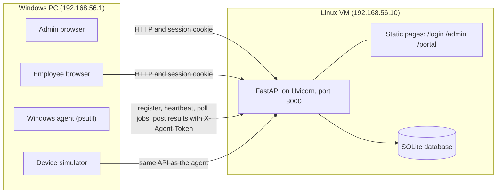
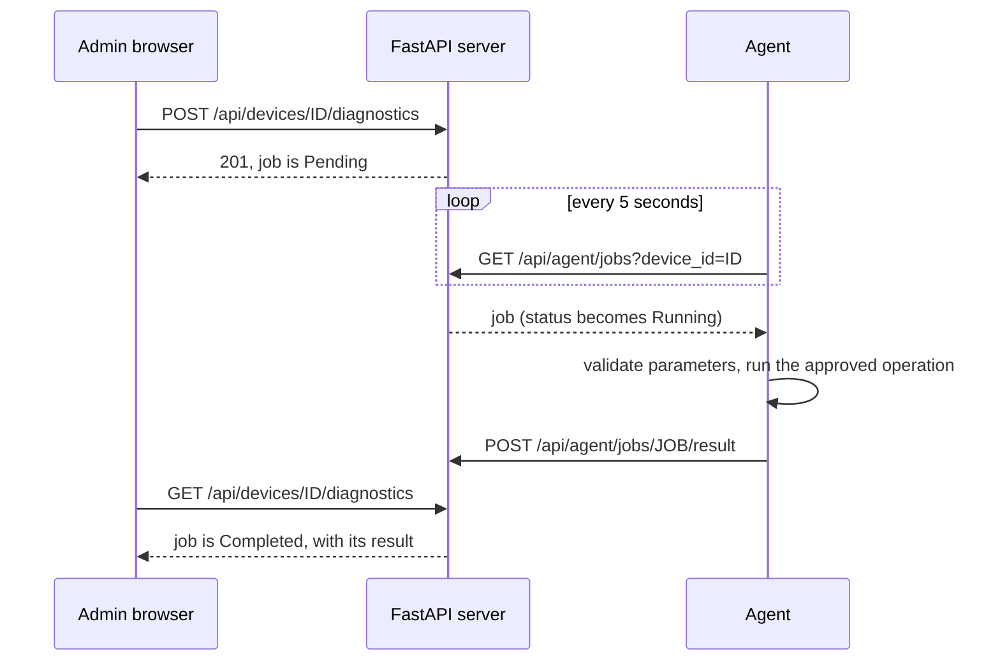
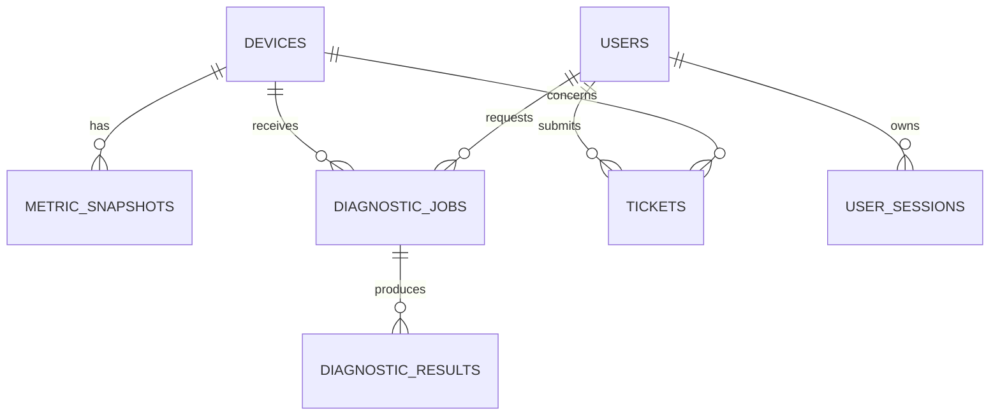

# Architecture

ManaGit is a small client/server platform. A FastAPI backend on a Linux server stores everything in SQLite and serves three web pages. Agents on the monitored devices report to it over HTTP.

## Components

| Component | Technology | Role |
|---|---|---|
| API server | Python, FastAPI, Uvicorn | REST API, authentication, business rules |
| Database | SQLite via SQLAlchemy | Devices, metrics, users, sessions, tickets, diagnostics |
| Admin dashboard | HTML, CSS, JavaScript | Fleet overview, device pages, diagnostics, ticket management |
| Employee portal | HTML, CSS, JavaScript | Report a problem, follow your own tickets |
| Windows agent | Python, psutil, requests | Registers the device, sends heartbeats and metrics, runs approved diagnostics |
| Device simulator | Python | Behaves like an agent for several fake devices |

## System diagram

## Data flows

### Heartbeat and device status
1. On start, the agent registers with a permanent `agent_id` (kept in `state.json`), so a restart updates the same device instead of creating a duplicate.
2. Every 60 seconds it sends CPU, RAM and disk usage. The server updates `last_seen` and stores a metric snapshot.
3. The status is **computed on every request**: a device is `offline` when `last_seen` is older than 90 seconds, otherwise `online`. Nothing needs to "mark" a device offline.
4. Metric snapshots older than 7 days are deleted at server start, so the SQLite file stays small.

### Remote diagnostics
The server cannot reach into a PC, so diagnostics use a **polling job queue**.

Rules enforced on the way:
- Only five operations exist: `ping`, `dns_lookup`, `tcp_check`, `system_info`, `resource_check`.
- Hostnames and IPs must match a strict pattern (it cannot start with `-`), and ports must be 1 to 65535.
- Validation runs on the server **and again on the agent**, so a compromised server still cannot make an agent run arbitrary commands. Commands run without a shell.
- Only online devices can be diagnosed, a device can have at most 5 unfinished jobs, and a job that is not finished within 5 minutes is marked Failed.
- Each job stores which administrator requested it.

### Tickets
1. A logged-in employee submits a ticket. The requester name comes from the account, never from the form, and an employee can only attach their own linked device.
2. The admin sees all tickets, changes the status (Open, In Progress, Resolved), adds notes and can link a device. A ticket cannot be resolved without a resolution note.
3. The employee sees only their own tickets, including the resolution note.

## Data model

Details are in [`database/schema_notes.md`](../database/schema_notes.md).

## Security model

| Concern | Measure |
|---|---|
| Passwords | scrypt with a random salt per user, minimum 10 characters, checked in constant time |
| Sessions | Random token in an `HttpOnly`, `SameSite=Lax` cookie. Only its SHA-256 hash is stored. Sessions last 8 hours and logout deletes them |
| Brute force | 5 failed logins for the same IP and username lock that pair for 5 minutes. A wrong username and a wrong password give the same answer and take the same time |
| Roles | `admin` and `employee`, checked on the server for every protected endpoint |
| Agents | Shared secret in the `X-Agent-Token` header, compared in constant time. The server refuses everything if no token is configured |
| Injection | Parameters validated against an allowlist, no shell, parameterised SQL through SQLAlchemy |
| XSS | All data from the API is inserted into pages with `textContent`, never `innerHTML` |
| Secrets | `.env`, `config.json` and `state.json` are never committed. Real values are replaced by `change-me` in the example files |

## Design decisions
- **Polling instead of push** for diagnostics, because agents sit behind NAT or firewalls and the server cannot connect to them.
- **Computed status** instead of a stored flag, so there is no background job that can fall behind.
- **Naive UTC timestamps** in the database, marked as UTC when the browser parses them.
- **SQLite** because a single small server needs no database service. It is the main scaling limit (see the README).
- **Static front-end served by FastAPI**, with no build tools, which suits a 1 GB VM.
